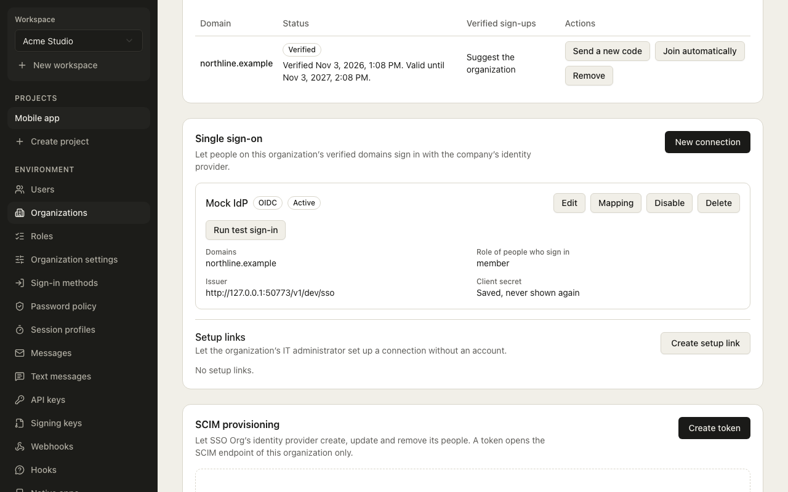

# Enterprise single sign-on: the guide

How to take a company from "we have an identity provider" to "everyone signs in through it, and
leaves when the directory says so". This page is the path through the whole feature. The
protocol details (every OIDC and SAML check, the error codes) are on
[Enterprise single sign-on (OIDC and SAML)](methods/sso.md), the reasons are in
[ADR 0067](adr/0067-enterprise-sso.md), and provisioning has its own page,
[SCIM provisioning](scim.md).

| You want to | Go to |
| --- | --- |
| Connect Okta, Entra ID, Google Workspace, JumpCloud, OneLogin or Ping | [The identity provider pages](#the-identity-provider-pages) |
| Let the customer's IT administrator do the setup | [The setup portal](#the-setup-portal) |
| Force everyone through the provider | [Enforcement and break-glass](#enforcement-and-break-glass) |
| Create, change and deactivate users from the directory | [SCIM provisioning](scim.md) |
| Prove who changed what | [Exporting the audit log](audit-export.md) |

## The pieces

- A **connection** is one identity provider for one [organization](organizations.md), in one
  environment. It is OIDC or SAML, has a status (`draft`, `active`, `disabled`, never back to a draft) and
  serves the domains you list.
- A **verified domain** is the proof that the organization owns the email domain
  ([Verified domains](verified-domains.md)). A connection may only list domains its organization
  has verified (`sso.domain_not_verified`), and one active connection serves a domain
  (`sso.domain_taken`).
- **Home-realm discovery is by domain, never by account.** The sign-in asks for an address; if its domain
  is bound to an active connection the step offers `sso`. A known and an unknown address on that
  domain get the same answer, so the step cannot be used to find out who has an account.

## Turn it on

SSO needs two settings: `organizations.enabled` and `sso.enabled` (both off by default). Then, per
organization: verify the domain, create the connection, give the identity provider the values Tula
shows, map attributes and groups, run a test sign-in and activate.

### Create the connection

An OIDC connection takes an issuer, a client id and a client secret; a SAML connection takes the
provider's metadata. The answer of a SAML connection holds the values to give the provider.

<!-- snippet: examples/docs-snippets/sso.ts#sso-create-saml -->
```ts
const { data: connection } = await admin.call('createSsoConnection', {
  body: {
    organizationId,
    protocol: 'saml',
    name: 'Acme Okta',
    saml: { metadataUrl: 'https://acme.okta.com/app/exk1abc/sso/saml/metadata' },
    // The preset names the attributes the provider sends; see the provider's page.
    attributeMapping: { idp: 'okta' },
    domains: ['acme.com'],
  },
})
// Paste these into the identity provider.
const { acsUrl, spEntityId } = connection.saml ?? {}
```
<!-- /snippet -->

### Map attributes and groups

`attributeMapping.idp` picks the built-in names of one of seven presets (`okta`, `entra`,
`google_workspace`, `jumpcloud`, `onelogin`, `ping`, `generic`); a named `email`, `firstName`,
`lastName` or `groups` replaces that field's names only. The names each preset reads are on the
page of its provider.

Groups become roles through a mapping held **per organization** (SCIM groups read the same one). The
**order is the precedence**: a user in several mapped groups gets the role of the first mapped group,
in the saved order, that they are in. A user in none of them gets the connection's `defaultRole`; an
organization with no mapping leaves a member's role alone. The role is set at every sign-in through
the organization service, so the last manager of an organization is never demoted: that sign-in
succeeds with the old role.

<!-- snippet: examples/docs-snippets/sso.ts#sso-group-roles -->
```ts
await admin.call('replaceSsoGroupRoles', {
  params: { id: connectionId },
  body: {
    mappings: [
      { group: 'tula-admins', role: 'admin' },
      { group: 'everyone', role: 'member' },
    ],
  },
})
```
<!-- /snippet -->

> [!NOTE]
> A group name is directory data. It is kept for the length of a sign-in and in the mapping, and is never
> in an audit entry, an event or a log line.

### Test sign-in, then activate

A **test sign-in** runs the whole round trip against the real provider and **creates nothing**: no
user, identity, membership or session. It is the one place a refusal is explained (a wrong audience, an
unsigned assertion, an expired certificate, an address outside the domains); a real sign-in always
answers the single `sso.provider_error`. It also shows the attributes and groups the provider sent and
how they were mapped, which is how you find a wrong attribute name before a user does.

A connection stores a fingerprint of the settings a sign-in depends on, and is `tested` only while it
matches. **Activating without a passing test on the current settings is refused** with
`sso.test_required`; change the provider's values and you test again.

<!-- snippet: examples/docs-snippets/sso.ts#sso-test-activate -->
```ts
const { data: test } = await admin.call('startSsoConnectionTest', {
  params: { id: connectionId },
  body: { redirectUrl: 'https://auth.example.com/dashboard/' },
})
// Open test.authorizationUrl in a browser and sign in; it returns with #tula_test=<testId>.
const { data: result } = await admin.call('getSsoConnectionTest', {
  params: { id: connectionId, testId: test.testId },
})
if (result.status === 'passed') {
  // Activation without a passing test is refused with `sso.test_required`.
  await admin.call('updateSsoConnection', {
    params: { id: connectionId },
    body: { status: 'active' },
  })
}
```
<!-- /snippet -->

## In the dashboard

An operator finds all of this on an organization's page in the dashboard (**Organizations**, then the
organization), in the sections below **Domains**:



- **Single sign-on** lists the organization's connections with their protocol (SAML or OIDC) and status,
  and **New connection**, **Edit**, **Activate** or **Disable** and **Delete** for each. A SAML connection
  shows the *Values for your identity provider* (entity id, reply URL (ACS) and metadata URL, each with a
  copy button, and a download of the metadata) and a warning when a signing certificate has ended or
  is about to. A connection that people have signed in through cannot be deleted: disable it. The section
  says so when `sso.enabled` is off in the environment.
- Editing a connection has the switches **Require this connection**, **Trust the identity provider for
  two-step verification** and the **Break-glass role** (anyone with it keeps password sign-in).
- **Setup links** (on the same section) lists the organization's links and has **Create a setup link**.
  The new link's address is shown once, in a dialog (*Copy this setup link now*), and is not shown
  again; each link can be revoked.
- The test sign-in and the group-to-role mapping are not drawn in the dashboard yet; use the admin API
  (the snippets on this page) or the setup portal.

## Enforcement and break-glass

By default SSO is one way in among the others. With `enforced: true` on an **active** connection,
every other first factor is removed for the addresses of its verified domains: the step offers only
`sso`, and the password, the emailed code and link, the texted code, a passkey and a provider
sign-in (OAuth) each answer `auth.method_disabled`, to everyone.

**Break-glass keeps password sign-in, and only that.** `breakGlassRole` names an organization role; a
member of the connection's organization who holds it can still sign in **with a password**, so an
identity provider outage does not lock the administrators out. Nothing else is let through for them:
not an emailed code, not a passkey. To keep the answers from revealing who is a member, the password
step on an enforced domain answers `auth.invalid_credentials` (after a real or dummy password check)
to an unknown address, a non-member and a member with a wrong password alike.

> [!WARNING]
> Choose the break-glass role before you enforce, and give that account a strong password and
> [two-step verification](methods/two-step-verification.md). Enforcement with no break-glass role and a
> failed identity provider locks out the whole domain.

### Trust the provider's MFA

With `trustIdpMfa: true` an SSO sign-in records `sso` and `mfa` among the session's authentication
methods and asks for no further factor, also under `mfa.policy: required`. Leave it off and the
sign-in goes on to a second factor like any first factor. Turn it on only when the provider really
requires MFA for these users.

<!-- snippet: examples/docs-snippets/sso.ts#sso-enforce -->
```ts
await admin.call('updateSsoConnection', {
  params: { id: connectionId },
  body: { enforced: true, breakGlassRole: 'admin', trustIdpMfa: true },
})
```
<!-- /snippet -->

Switching enforcement **off**, turning `trustIdpMfa` **on**, setting a break-glass role and activating a
connection are **weakenings**: the audit entry says `weakened: true`, and an organization
administrator must have signed in recently for them (`auth.step_up_required` otherwise).

## The setup portal

A company's IT administrator rarely has an account in your product. An operator, or an organization
administrator who holds `org:sys:sso:manage`, makes a **setup link** (1 to 30 days, 7 by default,
revocable); the administrator opens it with no account and does the setup there.

<!-- snippet: examples/docs-snippets/sso.ts#sso-setup-link -->
```ts
const { data: link } = await admin.call('createSetupLink', {
  body: { organizationId, name: 'Acme IT', expiresInDays: 7 },
})
// Send link.url; the token is in its fragment and is not shown again.
```
<!-- /snippet -->

- **The token is shown once** and stored only as a hash. It is in the **fragment** of the address
  (`/dashboard/setup#…`), which no server or referrer sees; the page reads it, removes it from the address
  bar and keeps it in memory only.
- **What the portal can do**, for its organization only: create and edit the connection, refresh the
  metadata, map attributes and groups, run the test sign-in and activate. In a SCIM-enabled
  environment it can also issue the organization's SCIM token, shown once (see
  [SCIM provisioning](scim.md#groups)).
- **What it cannot do:** change enforcement, trust in the provider's MFA, the break-glass role or the default
  role, and delete a connection. Those change the organization's security posture and stay with an
  operator or a signed-in administrator.
- **It may not hand out privileged roles.** Through a link, a group can be mapped only to a role that
  holds no `org:sys:*` permission (so not the built-in `admin`, nor a custom role with a system
  permission), and an existing privileged mapping is shown read-only. A leaked link must not let
  its holder make their own group an administrator. An operator, or an administrator holding
  `org:sys:sso:manage` signed in, can map any role.
- Everything done through a link is audited with the actor `setup_link`, a used link records when, and
  expired links are deleted by the retention job. Revoke a link in one click.

> [!IMPORTANT]
> Treat a setup link like an invitation to administer sign-in: whoever holds it controls which provider
> signs the organization's people in, and so which groups it reports. Send it over a channel you trust.

## Organization administrators manage their own SSO

A signed-in member who holds the system permission **`org:sys:sso:manage`** (the built-in `admin` role
does) can list, create, change, test, activate and delete the organization's connections themselves,
under `/v1/client/me/organizations/:organizationId/sso-connections`, or in `<OrganizationProfile>`'s
SSO tab of `@tula-tech/react` (OIDC connections; SAML, group roles and the test are not drawn there yet,
and `organizations.sso` of `@tula-tech/core` has them all).

It is the same code as the operator's routes, so every rule above applies unchanged: the activation
gate, the domain rule and the weakenings. The permission is read from the caller's membership on every
call; a member without it, a user who is not a member and another organization's connection are all
refused. The client secret is write-only.

## The identity provider pages

Each page has the exact values to paste in both directions: what Tula gives the provider and what the
provider gives Tula. **None of the console steps has been checked against a live console yet**
(that is TULA-152); the pages say so, and cite the vendor documentation.

| Provider | SAML | OIDC |
| --- | --- | --- |
| [Okta](sso-providers/okta.md) | yes | yes |
| [Microsoft Entra ID](sso-providers/entra.md) | yes | yes |
| [Google Workspace](sso-providers/google-workspace.md) | yes | no |
| [JumpCloud](sso-providers/jumpcloud.md) | yes | yes |
| [OneLogin](sso-providers/onelogin.md) | yes | yes |
| [Ping Identity](sso-providers/ping.md) | yes | yes |

Any other provider that speaks SAML 2.0 or OpenID Connect uses the `generic` preset.

## Provisioning and the audit trail

SSO signs people in; [SCIM](scim.md) creates, updates and deactivates them, and
[their groups](scim.md#groups) set their roles. Every change of a connection, a setup link, a SCIM token
or a directory-provisioned user is an audit entry, and
[Exporting the audit log](audit-export.md#single-sign-on-and-provisioning-events) lists them.

## Limits you should know

- SAML is SP-initiated only: an IdP-initiated response is refused. Assertions must be signed, with RSA and
  SHA-256 or better, and not encrypted.
- Groups: at most 200 values of 256 characters are read from a profile, and a mapping holds a bounded
  number of entries.
- Activating a connection widens who can sign in and is audited as a weakening.
