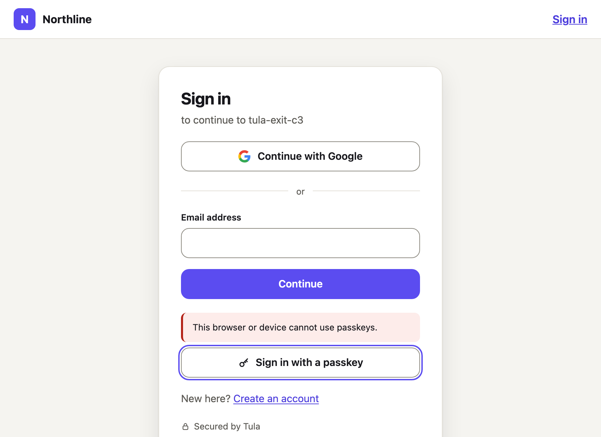

# Quickstart: from nothing to a signed-in user

You need [Bun](https://bun.sh) 1.2 or newer and Docker.

> **What is on npm, and what is not.** The web packages and `create-tula` are released to npm
> under the `alpha` dist-tag ([releasing.md](releasing.md)), so for a web app steps 2 and 3
> can be `bunx create-tula@alpha my-app --framework react-vite`. **No Tula API image is in a
> registry yet**: step 1 still happens in a checkout of this repository. **The Expo SDK is not
> released**: `--framework expo` is refused without `--tula-packages`, so for it steps 2 and 3
> stay as written. The steps below, all from a checkout, are the ones that were run; the
> path through npm has not been walked yet.

## 1. Build the API image

In the Tula repository:

```sh
docker build -f apps/api/Dockerfile -t tula-api:local .
```

`tula-api:local` is the image a new project names by default (`TULA_API_IMAGE` in its `.env`;
`--api-image` in step 3 names another).

## 2. Pack the packages

```sh
bun install
bun run packages:check       # builds and packs every package into .release/
```

`.release/` now holds `create-tula-0.0.0.tgz` and one `tula-tech-<name>-0.0.0.tgz` per package.

## 3. Create the project

Anywhere outside the repository:

```sh
mkdir -p /tmp/create-tula && tar -xzf <repo>/.release/create-tula-0.0.0.tgz -C /tmp/create-tula
bun /tmp/create-tula/package/dist/bin.js my-app \
  --framework react-vite \
  --tula-packages <repo>/.release
cd my-app
bun install
```

`--framework` is `react-vite` or `nextjs` for a web app, and `expo`, `swiftui` or `compose`
for a native one: [the native path](#the-native-path) below replaces steps 3 and 6 for those.
`--tula-packages` points the project's `@tula-tech/*`
dependencies at the tarballs; leave it out to install the released packages from npm (not
for `expo`, whose SDK is not released). `--api-port` and
`--mailpit-port` move the two published ports (3003 and 8025) if they are taken.

The project has a `.env` with secrets generated for it (a master key, an instance admin token,
two database passwords; readable by you only and ignored by git). **Back up
`TULA_MASTER_KEY`**: the stored signing keys and provider credentials cannot be opened without
it.

## 4. Start the stack

```sh
bunx tula dev
```

This starts Postgres, Redis, Mailpit and the API with Docker Compose, runs the migrations,
seeds a default project with a development and a production environment, mints development
keys into `.env.local`, and prints:

```text
Tula is running.
  API              http://localhost:3003
  API reference    http://localhost:3003/v1/docs
  Mail (Mailpit)   http://localhost:8025
  Publishable key  tula_pk_dev_…
  Secret key       in .env.local; --show-keys prints it
```

Run it again whenever you like: it reuses what is there. If a port is taken, change `API_PORT`
or `MAILPIT_UI_PORT` in `.env` and run `bunx tula dev` again.

## 5. Check it and apply your settings

```sh
bunx tula doctor      # database, migrations, master key, mail, Redis, URLs: each with its fix
bunx tula diff        # what tula.config.ts would change
bunx tula apply       # make the server match it
```

## 6. Sign up

```sh
bun run dev
```

Open the app (<http://localhost:5174> for Vite, <http://localhost:3000> for Next.js), choose
**Create an account**, and enter a name, an email address and a password. The verification
code arrives in Mailpit (<http://localhost:8025>): type it in, and you are signed in.



## 7. Google and a passkey, without touching server code

Both are settings of the environment, so they go in `tula.config.ts` and nothing else changes.
In the `dev` entry:

- under `settings.signIn.methods`, add `passkey: { enabled: true }`;
- beside it, `passkeys: { rpId: 'localhost' }` and
  `urls: { allowedOrigins: ['http://localhost:3000'] }` (the app's origin: passkeys need it
  listed even locally; use `5174` for Vite);
- beside `settings`, `providers: { google: { clientId: '…', clientSecret: env('GOOGLE_CLIENT_SECRET') } }`,
  importing `env` from `@tula-tech/config`.

```sh
export GOOGLE_CLIENT_SECRET=…   # the secret is read from the environment, never from the file
bunx tula diff
bunx tula apply
```

Reload the sign-in page: it now has **Continue with Google** and **Sign in with a passkey**,
and the account page has a **Passkeys** section. The app's code did not change; the components
draw what the environment enables.

For real Google credentials follow [providers/google.md](providers/google.md). To try the
button before you have any, add `OAUTH_MOCK_PROVIDER=true` to the project's `.env` and run
`bunx tula dev` again: Google is then served by a built-in mock whose consent page signs in as
whatever address you type. It is for local development only, and `tula doctor` warns while it
is on.

This path was last run end to end on 2026-10-04 with the Next.js template, the mock provider
and Chromium's virtual authenticator: sign up, add a passkey, sign out, sign in with the
passkey, sign in with the Google button. Real Google and a physical authenticator were not
exercised ([what was not verified](plans/phase-1-unverified.md)).

## The native path

The same stack, with an Expo, a SwiftUI or a Compose app in place of the web one. Steps 1,
2, 4 and 5 are as above; this replaces steps 3 and 6. The order is: scaffold, start the
stack, run the app in a simulator or an emulator, open the tunnel, then run it on a phone.

> **What was run, and what was not.** The three templates were scaffolded, and the SwiftUI
> and Compose ones compiled, on the machine that wrote them. **Nobody has run a scaffolded
> native project in a simulator, on an emulator or on a phone, and nobody has run
> `tula dev --tunnel` against a phone.** The steps from "Run it in a simulator" on are what
> the pieces are built to do, written for you to take; [what was not
> verified](plans/phase-2-unverified.md) lists each one. What needs an Apple or a Google
> account of your own is one table:
> [native-apps.md](native-apps.md#what-needs-your-own-accounts).

### Scaffold

```sh
bun /tmp/create-tula/package/dist/bin.js my-app --framework expo --tula-packages <repo>/.release
bun /tmp/create-tula/package/dist/bin.js my-app --framework swiftui --tula-repo <repo> --tula-packages <repo>/.release
bun /tmp/create-tula/package/dist/bin.js my-app --framework compose --tula-repo <repo> --tula-packages <repo>/.release
cd my-app
bun install
```

One of the three. The app is in a directory of its own beside the stack's files: `app`
(Expo), `ios` (an Xcode project) or `android` (a Gradle build). The project's own
`package.json` holds the `tula` command and `tula.config.ts`, as for a web app.

`--tula-repo` is a checkout of the Tula repository. The Swift package and the Kotlin
libraries are published nowhere, and `create-tula` names no registry that does not exist, so
a SwiftUI or a Compose project names its SDK by a path into the checkout, and the Compose
one is built with the checkout's Gradle wrapper. Keep the checkout where it is, or change
the path the project's `README.md` points at. The option is refused for the other
frameworks.

`--tula-repo` must be a checkout you trust: building the project runs its build scripts.
Gradle runs the checkout's settings, its modules' build files and its wrapper, and Xcode
evaluates its `Package.swift`, on your machine. The path from the project to it holds
letters, digits, dots, dashes and underscores only: a directory with a space in its name is
refused before anything is written.

### Start the stack

```sh
bunx tula dev
```

As in step 4. Note the API's address and the publishable key it prints: the app is given
both, and nothing else. No native app is ever given the secret key.

### Run it in a simulator or an emulator

A simulator and an emulator run on this machine, so the API's loopback address is enough and
no account of any kind is needed.

Expo, in an iOS simulator (needs Xcode) or an Android emulator (needs Android Studio's SDK):

```sh
cd app
bun install
cp .env.example .env.local    # then fill in the two values the project's README names
bunx expo run:ios             # or: bunx expo run:android
```

The API's address is `http://localhost:3003` for the iOS simulator and
`http://10.0.2.2:3003` for the Android emulator, which reaches the machine it runs on under
that name. It is a development build, not Expo Go: the app has native modules Expo Go does
not carry.

SwiftUI (needs Xcode with an iOS simulator runtime):

```sh
open ios/TulaExample.xcodeproj
```

Pick an iPhone simulator, run the `TulaExample` scheme, and type the API's address
(`http://localhost:3003`) and the publishable key on the app's setup screen.

Compose (needs a JDK 17 or newer, an Android SDK with the platform and build tools the
project's `README.md` names, and a running emulator):

```sh
ANDROID_HOME=<your SDK> <repo>/native/android/gradlew -p android :app:installDebug
adb shell am start -n dev.tula.example.compose/.MainActivity \
  -e tula_api_url http://10.0.2.2:3003 \
  -e tula_publishable_key <the publishable key>
```

In each app, create an account with an email address and a password. The verification code
arrives in Mailpit (<http://localhost:8025>), as in step 6.

### Open the tunnel

A phone cannot reach `localhost`, and a passkey, an app link and a provider's own sheet need
`https` on a name the phone trusts.

```sh
bunx tula dev --tunnel
```

It serves the same stack under this machine's Tailscale Funnel address and prints that
address. The Tailscale client, and the account it is signed in to, are your own: the command
carries no credential of its own. It changes **no setting**: it prints the values to put in
`tula.config.ts` yourself (`passkeys.rpId`, the allowed origins, the redirect URLs and the
app under `nativeApps`), which you then apply with `bunx tula diff` and `bunx tula apply`.
It refuses to start while the mock provider or the development inbox is switched on, and
says which line to change. `bunx tula dev down`, or `bunx tula dev` without the flag, closes
the tunnel. Everything else, the signals that close it and the ones that do not among them,
is in [cli.md](cli.md#tula-dev---tunnel).

### Then on a phone

Give the app the address the tunnel printed in place of the loopback one, and build it onto
the phone:

- **Expo**: set `EXPO_PUBLIC_TULA_API_URL` in `app/.env.local` to the tunnel's address, then
  `bunx expo run:ios --device` or `bunx expo run:android --device`.
- **SwiftUI**: choose the phone as the run destination in Xcode and type the tunnel's
  address on the setup screen. Xcode asks for a development team to sign the app with.
- **Compose**: the same two commands with the phone connected, and the tunnel's address as
  `tula_api_url`.

A sign-up with an email address and a password, and a sign-in with an emailed code, need
nothing more than that. A passkey, Sign in with Apple, Sign in with Google and an app link
each need an identifier that is yours, registered with Apple or Google and with Tula: the
example apps' identifiers are not yours to register. [The table in
native-apps.md](native-apps.md#what-needs-your-own-accounts) says, row by row, which account
each one needs and what you then give Tula; the SDK's own guide ([expo.md](expo.md),
[swift.md](swift.md), [kotlin.md](kotlin.md)) says what the app is given.

## Afterwards

```sh
bunx tula policy test          # try a password against the environment's policy
bunx tula dev down             # stop the stack; the data is kept
bunx tula dev down --volumes   # stop it and delete the database
```

Every command and option is in [cli.md](cli.md); settings as code in [config.md](config.md);
each sign-in method in [its own page](README.md#sign-in-methods); running Tula for real in
[self-host.md](self-host.md).
