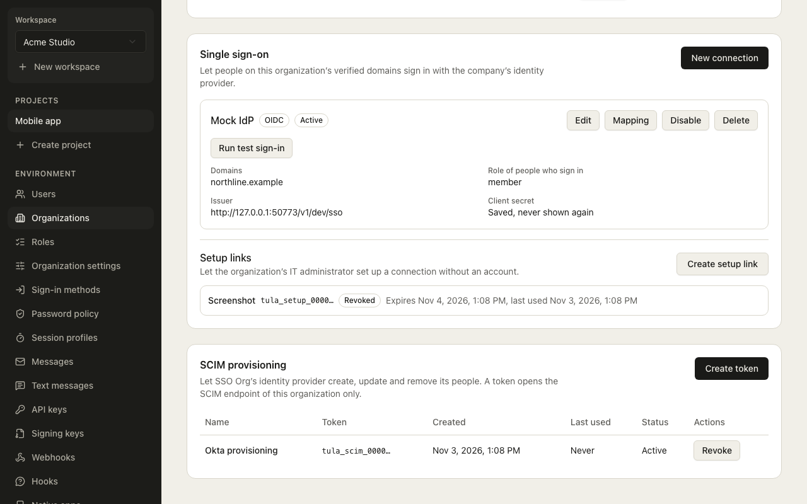

# SCIM provisioning

An organization's identity provider (Okta, Microsoft Entra ID, and any other that speaks SCIM
2.0) can create, update, deactivate and delete its people in Tula by itself. SCIM provisions for one
[organization](organizations.md), so it exists only while the environment has
`organizations.enabled` on; while it is off every SCIM route answers 403.

The SCIM routes are called by an identity provider, never by an app, so they are not in the
OpenAPI document and no SDK is generated from them. The routes that manage SCIM tokens are.

## Create a token

A **SCIM token** belongs to one organization and one environment. Create it with a secret key
(`POST /v1/admin/scim-tokens`, body `{ "organizationId": "…", "name": "Okta" }`) or in the
dashboard: on the organization's page, the **SCIM provisioning** section has **Create token**. It
lists the tokens (name, the start of the token, created, last used) with a revoke action, and creating
one opens a dialog, *Copy this token now*, with the token and the **SCIM base URL** to paste into the
identity provider. That is the only time the token is shown.

 The token looks like `tula_scim_<environment>_…`, is
**shown once**, and is stored only as a hash. List the tokens of an organization with
`GET /v1/admin/scim-tokens?organizationId=…` (the secret is never in the list) and revoke one
with `DELETE /v1/admin/scim-tokens/:id?organizationId=…`.

A SCIM token opens `/v1/scim/v2` and nothing else, and no other key (secret, agent or
publishable) opens `/v1/scim/v2`. Paste it into the identity provider as a bearer token, with
the base URL `https://<your api>/v1/scim/v2`. Each token is limited to 600 requests a minute and
each organization to 1,200 across its tokens.

## What the server supports

| Route | Meaning |
| --- | --- |
| `POST /Users` | Create a user, or link the existing user with that address. |
| `GET /Users` | List, with `startIndex`, `count` (at most 200) and `filter=userName eq "…"` or `filter=externalId eq "…"`. Any other filter is 400 `invalidFilter`. |
| `GET /Users/:id` | Read one. |
| `PUT /Users/:id` | Replace: `active` and `externalId` are applied, and so are `name.givenName`, `name.familyName` and `userName` (the address, on a verified domain of the organization, and not taken) for a user the directory manages. |
| `PATCH /Users/:id` | `add`, `replace` and `remove` (any case) on `active` and `externalId`, with a path or an object value. `active` may be a boolean or the string `"True"` or `"False"`, as Entra sends it. `userName` changes the address as on a PUT. Other attributes are accepted and ignored. Every resource has `meta.location`. |
| `DELETE /Users/:id` | Remove the user from the organization. |
| `GET /ServiceProviderConfig`, `/ResourceTypes`, `/Schemas` | Discovery. |

Bulk, sorting and ETags are not supported, and discovery says so. Groups are covered
[below](#groups). Errors on these
routes are SCIM error documents (RFC 7644) with `application/scim+json`, for example a
duplicate `userName` is 409 with `scimType: "uniqueness"`.

## Attribute mapping

| SCIM attribute | In Tula |
| --- | --- |
| `userName` (else the primary of `emails`) | The user's email address. It must be an address; it is **never changed** by SCIM afterwards, and a managed user cannot change it from a client. A managed user cannot change their password from a client either (`user.managed`, 403) while the directory has a live token; administrators still can. |
| `externalId` | The directory's own id, kept to find the user again (`filter=externalId eq "…"`). |
| `name.givenName`, `name.familyName` | First and last name (at most 100 characters each). For a user the directory manages, a `PUT` or `PATCH` updates them; for anyone else they are left alone. |
| `name.givenName`, `name.familyName` (note) | The managed-account lock (`user.managed`) guards only the address and the password. A managed user can still change their name from a client, and the directory overwrites it on its next sync of that user. |
| `active` | `false` deactivates (below), `true` restores. |
| Any other attribute | Accepted and ignored. |

## Whose account it is, and what deactivation does

A user the directory creates is **managed by the directory** and gets a membership. A new
account is created only on a [verified domain](verified-domains.md) of the organization (not
lapsed); on any other the create is a 400 `invalidValue` and nothing is created. A user who
already exists is linked only when the address is on a [verified domain](verified-domains.md) of
the organization; otherwise the create is a 409. The user's email is not changed by SCIM, and a
managed user cannot change it from a client.

- **Deactivate** (`active: false`) removes the membership. If the directory manages the user and
  they have no other membership, the account is also banned and its sessions are revoked, so
  the access token is refused at once. Setting `active: true` again restores access.
- **Delete** removes the membership, and deletes the account only if the directory manages it
  and the user has no other membership.
- **Reactivate** (`active: true`) lifts only the ban of the directory's own deactivation. A ban an operator set
  in the dashboard or through the admin API outlives the directory: a routine `active: true` does not undo it.
- A user the directory does not manage, or who belongs to another organization, is never banned
  or deleted by SCIM.
- The organization's **last manager** cannot be removed: deactivate and delete answer 409, as
  in [organizations](organizations.md).

Every change is an audit entry whose actor is the `directory` (the token's id), and its event
carries ids and flags only.

## Identity provider notes

> [!NOTE]
> The console wording is **not verified** against a live console; what follows is the values
> Tula expects and what its code accepts.

### Okta

Base URL `https://<your api>/v1/scim/v2`; the SCIM token is sent as a bearer token; `userName` carries
the email address. Push new users, profile updates and deactivation (`active: false`); where Okta
asks for these: not verified.
<!-- Vendor docs: https://help.okta.com/en-us/content/topics/apps/apps_app_integration_wizard_saml.htm covers the app wizard only; the SCIM provisioning page was not located. -->

### Microsoft Entra ID

Tenant URL `https://<your api>/v1/scim/v2` and the SCIM token as the secret token. Entra sends `active` as
the string `"True"` or `"False"` and patch operations with any case of `op`; Tula accepts both.
<!-- Vendor docs, resolves 2026-11-03, content not compared: https://learn.microsoft.com/en-us/entra/identity/app-provisioning/use-scim-to-provision-users-and-groups -->

## Groups

The identity provider can push **groups** to `/v1/scim/v2/Groups`: create, get, list (with
`filter=displayName eq "…"`, `startIndex` and `count`), replace (`PUT`), patch (members added and removed) and
delete. `ServiceProviderConfig`, `ResourceTypes` and `Schemas` say that Groups are supported.

- **A group's members get the role the group is mapped to.** The mapping is the organization's
  group-to-role mapping, the same one single sign-on uses ([the guide](enterprise-sso.md#map-attributes-and-groups)),
  with the same precedence: the first mapped group in the saved order wins. A change of a group's
  members in the directory changes the member's role at their **next refresh**.
- **An unmapped group is stored and has no effect.**
- **A user the directory creates, or adds to a group no mapping names, gets the connection's default role**, the same as a single sign-on sign-in.
- **Member patches** accept Okta's and Entra's shapes: `members` with `add`, `remove` and `replace`, `op`
  in any case, and `value` as an array of `{ "value": "<user id>" }`.
- **Atomic.** A patch that would remove the organization's **last manager** is answered 409 and
  **nothing** in the patch is applied.
- **Group names are directory data.** A group's `displayName` is never in an audit entry or an event;
  entries carry ids and counts only.
- Membership changes go through the organization service, so every rule of
  [organizations](organizations.md) (the last manager among them) holds.

### Getting the token from the setup portal

The organization's IT administrator can create the organization's SCIM token in the
[setup portal](enterprise-sso.md#the-setup-portal), in the same sitting as the connection. It is shown
**once**, never again, is limited to the link's organization and is recorded with the actor `setup_link`.
